<!-- mcp-name: io.github.heuristicolab/ctxfw -->
<div align="center">

# CTXFW // CONTEXT FIREWALL
### AI Agent Governance, Prompt Injection Firewall (`SARA`) & In-Memory AST Context Compactor for MCP Coding Agents

[](https://pypi.org/project/ctxfw/)
[](https://pepy.tech/project/ctxfw)
[](https://ctxfw.heuristicolab.com)
[](https://pypi.org/project/ctxfw/)
[](LICENSE)
[](https://glama.ai/mcp/servers/heuristicolab/ctxfw)
[](https://registry.modelcontextprotocol.io/v0/servers?search=ctxfw)
[](https://heuristicolab.com/vault)
[](https://www.skillsdirectory.com/authors/heuristicolab)

**The deterministic Zero-Egress boundary between probabilistic LLM hallucination, indirect prompt injection, and production infrastructure.**

[Installation](#installation--multi-surface-setup) • [Benchmarks](#ast-pruning-benchmarks) • [CTXFW vs. Cloud WAFs](#ai-agent-governance--prompt-injection-defense-ctxfw-vs-cloud-runtime-wafs) • [Diagnostic](#system-diagnostics) • [Architecture](#architecture) • [Enterprise Governance](#enterprise-governance)

<p align="center">
  
</p>

---

</div>

## Executive Abstract

Autonomous coding agents (Claude, Gemini, Cursor, Antigravity) consume massive context windows with bloated peripheral dependencies, triggering token exhaustion, context drift, and security degradation.

**CTXFW** is an open-core context firewall and Model Context Protocol (MCP) gatekeeper. It combines an **in-memory polyglot AST pruner** with a **deterministic axiomatic intake sieve**:
1. **Compacts Peripheral Code (72.4% token reduction)**: Replaces distance-1 and distance-2+ module implementations with clean interface signatures, type definitions, and functional stubs.
2. **Enforces Axiomatic Integrity (ACI $\ge$ 0.9000)**: Rejects ungrounded or deficient architecture briefs missing negative invariants ($N \ge 5$), bounded variable domains, deterministic state machines, or formal error taxonomies.
3. **Zero Telemetry Egress**: Guaranteed local execution with zero network telemetry leakage on standard operating mode.

---

## AST Pruning Benchmarks

CTXFW operates directly at the syntax tree layer using native polyglot grammars:

| Benchmark Dimension | Raw Context Ingestion | CTXFW Topological Compactor | Performance Gain / Impact |
| :--- | :--- | :--- | :--- |
| **Token Consumption** | 100% (Raw Files) | 27.6% (Interface Stubs) | **72.4% Bloat Eliminated** |
| **Engine Compaction Overhead** | — | Native in-memory parser | **< 5.0 ms** |
| **Warm Cache Hit Overhead** | — | SQLite WAL semantic cache | **< 0.8 ms** |
| **Stdio Telemetry Egress** | Unsanitized stdout | Pure isolated JSON-RPC | **Zero Egress (100% Isolated)** |
| **Axiom Verification Latency** | — | Sieve evaluation | **< 12.0 ms** |
| **CI/CD Pre-Commit Latency** | — | Headless git sentry | **< 85.0 ms** |

### Empirical Case Study: `ctxfw/cli.py` Core Dependency Graph

Empirical context reduction metrics generated via `ctxfw.resolve_context_bundle` running against 16 internal dependencies:

| Dimension | Raw Context Ingestion | CTXFW Topological Sieve | Performance Delta |
| :--- | :--- | :--- | :--- |
| **Total Context Size** | 49,096 tokens | 20,014 tokens | **-59.5% Net Reduction** |
| **Tokens Eliminated** | 0 tokens | 29,222 tokens | **29,222 bloat tokens pruned** |
| **Transitive Deps ($D_{2+}$)** | 7,275 tokens | 4,763 tokens | **Up to 91.9% reduction** |
| **FinOps Cost Impact** | Base Cost | Reduced by $0.0877 USD / prompt | **~$87.70 USD saved per 1K calls** |
| **AST Compaction Latency** | — | 1,407.96 ms | In-memory Tree-Sitter parsing |
| **Attestation Integrity** | None | SHA-256 sealed | Strict interface preservation |

**Topological Hierarchy Breakdown:**
- **$D_0$ Target (`ctxfw/cli.py`)**: 100% Full Implementation preserved.
- **$D_1$ Direct Deps (e.g. `gatekeeper.py`, `mcp.py`)**: Implementation truncated to typed stubs (`...`). Token savings: **73% – 86%**.
- **$D_2$ Transitive Deps (e.g. `polyglot.py`)**: Compact typed interface signatures. Token savings: **91.9%**.
- **$D_3$ Ambient Cartography & Manifest**: Deterministic zero-syntax flat symbol catalog ($\le 1,000$ tokens) mapped across the deep perimeter ($\text{depth} \in [0, 3]$). Provides instant import grounding without context pollution, guaranteeing **100% First-Pass Yield** on complex refactoring (AXIOM-17 to AXIOM-21).

### The Empirical Validation Trilogy (Multi-Repository Destructive A/B)

Audited on remote Linux environments (`root@isolated-runner`, Ubuntu 24.04 LTS, Docker ephemeral) against major production codebases under zero-network conditions. Full forensic dossier: [`docs/benchmarks/TRILOGY_EMPIRICAL_BENCHMARK.md`](docs/benchmarks/TRILOGY_EMPIRICAL_BENCHMARK.md).

| Target Repository | Architectural Archetype | Active Focal $D_0$ | Peripheral Perimeter $D_1$ | Raw Context ($D_0 + D_1$) | Pruned Context ($D_0 + D_1^*$) | $D_1$ Perimeter Savings | Aggregate Context Savings | MCP Leaks | Syntactic AST Pass | Latency / Throughput |
| :--- | :--- | :--- | :--- | :---: | :---: | :---: | :---: | :---: | :---: | :---: |
| **[`zulip/zulip`](https://github.com/zulip/zulip)** | Coupled Django Monolith | `users.py` (12.9k tok) | `realms.py`, `clients.py`, `prereg_users.py` (16.8k tok) | **29,689** | **22,481** | **-42.96%** *(Interface)*<br>**-78.20%** *(Nominal)* | **-24.28%** *(Interface)*<br>**-44.20%** *(Nominal)* | **0 B** | `100% PASS` | 44.1 ms<br>~380k tok/s |
| **[`PostHog/posthog`](https://github.com/PostHog/posthog)** | Modern COSS / Data OS | `team.py` (14.3k tok) | `organization.py`, `user.py`, `project.py` (20.6k tok) | **34,894** | **22,637** | **-59.53%** *(Interface)* | **-35.13%** *(Interface)* | **0 B** | `100% PASS` | 50.2 ms<br>~410k tok/s |
| **[`apache/airflow`](https://github.com/apache/airflow)** | Async Orchestration Monorepo | `dag.py` (9.4k tok) | `baseoperator.py`, `taskinstance.py`, `dagrun.py` (60.4k tok) | **69,861** | **29,433** | **-66.90%** *(Interface)*<br>**-90.26%** *(Nominal)* | **-57.87%** *(Interface)*<br>**-78.08%** *(Nominal)* | **0 B** | `100% PASS` | **138.2 ms**<br>**437,351 tok/s** |

**Key Empirical Highlights:**
- **Compression Scaling ($43\% \to 60\% \to 67\%$)**: Larger real-world codebases yield greater perimeter reduction ($60.4\text{k} \to 20.0\text{k}$ tokens in Airflow D1, eliminating **40,428 bloat tokens net**).
- **Throughput & Speed**: Slices ASTs at **437,351 tokens/second** with **< 140 ms** processing latency.
- **Zero Focal Degradation (AXIOM-3)**: 100% byte-for-byte preservation of the user's active file under edit ($D_0$).
- **Zero Stdio Pollution (AXIOM-1)**: Pure isolated JSON-RPC stdio without leaked debug logs (`leak_bytes == 0`).

---

## AI Agent Governance & Prompt Injection Defense: CTXFW vs. Cloud Runtime WAFs

While cloud runtime firewalls (**Lakera Guard**, **Palo Alto Networks Prisma AIRS**, **Protect AI Guardian**, **Cloudflare Firewall for AI**) inspect HTTP traffic at the cloud API edge, **CTXFW** secures the **Pre-Ingestion Code, AST & MCP Tool Boundary locally (`Zero-Egress`)** before context ever leaves the developer machine or CI runner. Full comparative dossier: [`docs/benchmarks/SECURITY_VS_CLOUD_WAFS.md`](docs/benchmarks/SECURITY_VS_CLOUD_WAFS.md).

| Capability / Security Dimension | **CTXFW (`Context Firewall v4.1.0`)** | **Lakera Guard** (`Check Point`) | **Palo Alto Prisma AIRS** | **Protect AI / Cloudflare AI WAF** |
| :--- | :--- | :--- | :--- | :--- |
| **Enforcement Boundary** | **Pre-Ingestion Local AST & MCP Tool `stdio` / Proxy** | Cloud HTTP Prompt API | Cloud Network & Runtime API | Cloud Edge / ML Inference Proxy |
| **Code & Data Sovereignty** | **100% Zero-Egress (Air-Gapped Local RAM & SQLite WAL)** | Requires Cloud API Egress | Cloud / Appliance Inspection | Cloud Proxy Egress |
| **Indirect Prompt Injection (`MCP` / Tools)** | **Deterministic `ctxfw.sara`**: **100.0% Recall / 0.0% FPR** (`<system>`, `[INST]`, Trojan-Source `U+202E` quarantine) | Probabilistic ML Classifier | Runtime Network Policy | Edge WAF / Heuristic Classifier |
| **FinOps Token Cost Reduction** | **42.96% – 90.26% $D_1$ AST Bloat Pruned** (~**$87.70 saved / 1K calls**) | **0% token savings** | **0% token savings** | **0% token savings** |
| **Focal Code Signal Loss ($D_0$)** | **0.00% Loss (`AXIOM-3`: 100% byte-for-byte $D_0$ preservation)** | N/A (Pass-through) | N/A (Pass-through) | N/A (Pass-through) |
| **Inspection Latency (P50 / P95)** | **0.33 ms P50 / 1.72 ms P95 (SARA) · < 0.8 ms (Warm WAL Cache)** | `35 ms – 120 ms` (Network RTT) | `25 ms – 90 ms` | `15 ms – 150 ms` |
| **Deployment Complexity** | **1 Command (< 10s)**: `pipx install ctxfw && ctxfw init` | SDK wrapper + API keys | TLS decryption + routing | DNS / Proxy routing |

Run the reproducible 24-vector OWASP AISVS `C02-01` & `arXiv:2510.05244v2` Indirect Prompt Injection & Trojan-Source benchmark locally with zero network egress:
```bash
python benchmarks/run_sara_security_benchmark.py
```

---

## Installation & Multi-Surface Setup

### 1. PyPI Installation
```bash
pip install --upgrade ctxfw
# or via pipx for dedicated binary isolation:
pipx install ctxfw
```

### 2. Multi-Surface MCP Auto-Configuration (v4.1.0)
Run `ctxfw init` or dedicated installation command `ctxfw install --claude` for automated zero-touch discovery and idempotent injection across your installed coding surfaces:
```bash
# Targeted Claude Code CLI & Claude Desktop auto-installation:
ctxfw install --claude

# Or full multi-surface discovery (Claude, Cursor, Windsurf):
ctxfw init
```

**Auto-Detected Surfaces (Triple Surface Architecture):**
1. **Claude Code CLI**: Injects directly into `~/.claude.json`.
2. **Claude Desktop**: Dynamic cross-platform detection:
   - macOS: `~/Library/Application Support/Claude/claude_desktop_config.json`
   - Windows: `%APPDATA%/Claude/claude_desktop_config.json`
   - Linux / POSIX: `~/.config/Claude/claude_desktop_config.json`
3. **Cursor IDE**: Injects into `.cursor/mcp.json` in workspace scope.
4. **Windsurf IDE**: Injects into `~/.codeium/windsurf/mcp_config.json` when the `.codeium` directory signature is present.

**Inviolable Safety & Reliability Invariants:**
- **Atomic Backup Snapshot (`.bak.<timestamp>`)**: Before mutating any pre-existing configuration file, creates a timestamped immutable backup.
- **Non-Destructive Merge**: Preserves 100% of pre-existing third-party MCP servers, top-level settings, and custom keys.
- **Zero-Failure Execution**: Dynamically resolves the interpreter to `sys.executable` with `["-m", "ctxfw.mcp"]` (or canonical absolute binary path if frozen via PyInstaller), completely eliminating ambient `$PATH` and virtualenv resolution failures.
- **3x Idempotency**: Multiple runs produce zero configuration drift and zero duplicated keys.

### 3. Zero-MCP Interoperability Gateway (Aider, OpenCode, Continue, CLI)
For AI developer tools and terminal agents lacking native Model Context Protocol support:
```bash
# 1. Start the zero-egress local proxy server:
ctxfw proxy --port 8765

# 2. Point your tool's Anthropic or OpenAI endpoint to localhost:
export ANTHROPIC_BASE_URL="http://localhost:8765/v1"
export OPENAI_BASE_URL="http://localhost:8765/v1"
```

### 4. Verified Registries, MCP Ecosystem Directories & Agent Skills
CTXFW is independently audited and certified with **Grade A** compliance across both the official **Glama MCP Registry** (`TDQS 4.5/5.0 · Security 100/100`) and **Skills Directory** (`Security: A 100/100` across 120 static security patterns), and indexed across the **7 MCP Ecosystem Directories**:

[](https://glama.ai/mcp/servers/heuristicolab/ctxfw)
[](https://registry.modelcontextprotocol.io/v0/servers?search=ctxfw)
[](https://heuristicolab.com/vault)
[](https://www.skillsdirectory.com/authors/heuristicolab)

- **Glama.ai MCP Directory (Grade A Certified)**: [`glama.ai/mcp/servers/heuristicolab/ctxfw`](https://glama.ai/mcp/servers/heuristicolab/ctxfw)
- **MCPMarket Directory**: [`mcpmarket.com/server/ctxfw`](https://mcpmarket.com/server/ctxfw)
- **GTMStacker Tool Registry**: [`gtmstacker.com/registry/tool/ctxfw/index.json`](https://gtmstacker.com/registry/tool/ctxfw/index.json)
- **VibeLeaderboard**: [`vibeleaderboard.ai/app/e109eca4-858b-41ed-816b-d932f45a7677`](https://www.vibeleaderboard.ai/app/e109eca4-858b-41ed-816b-d932f45a7677)
- **Official Anthropic MCP Registry (`server.json`)**: [`registry.modelcontextprotocol.io`](https://registry.modelcontextprotocol.io/v0/servers?search=ctxfw)
- **PulseMCP Directory**: [`pulsemcp.com/servers?q=ctxfw`](https://www.pulsemcp.com/servers?q=ctxfw)

Install the verified Claude Code / Agent skills directly into `.claude/skills/`:
```bash
npx -y skills add heuristicolab/ctxfw --skill context-firewall --agent claude-code
npx -y skills add heuristicolab/ctxfw --skill axiom-sieve --agent claude-code
npx -y skills add heuristicolab/ctxfw --skill eval-benchmark --agent claude-code
npx -y skills add heuristicolab/ctxfw --skill precommit-sentry --agent claude-code
```

Direct access to tool inspection, schemas, and live diagnostic telemetry on [Glama](https://glama.ai/mcp/servers/heuristicolab/ctxfw) and [Skills Directory](https://www.skillsdirectory.com/authors/heuristicolab).

---

## System Diagnostics

Validate local environment readiness, stdio isolation purity, SQLite WAL concurrency, and Tree-Sitter grammars with a single command:

```bash
ctxfw doctor
```

```text
========================================================================
  CTXFW DOCTOR // HIGH-ASSURANCE HEALTH & ISOLATION DIAGNOSTIC
========================================================================
[PASS]   Python Package & sys.path        ctxfw v4.1.0 loaded cleanly.
[PASS]   MCP stdio Stream Isolation       100% pure JSON-RPC on stdout. Diagnostic logs isolated to stderr.
[PASS]   Global CLI Executable (PATH)     Binary 'ctxfw' found in PATH.
[PASS]   Axiomatic Sieve Engine           Evaluation verified (ACI: 1.0000, Invariants: 5).
[PASS]   SQLite WAL Cache & Concurrency   Journal mode: WAL, Busy timeout: 5000ms.
[PASS]   Polyglot Tree-Sitter Grammars    Initialized language parsers (typescript, go, java).
[PASS]   TraceKit Ledger Audit            Chain status: INTACT (1275 blocks).
[PASS]   Sovereign Pentad WAL Ledgers     SARA scans: 331 | TokenCast turns: 1 (FinOps rows: 3872) | Rules: 1056 | SWE-Gate: 13.
------------------------------------------------------------------------
Overall Verdict:            [HEALTHY] [ATTESTED] Perimeter defense operational.
========================================================================
CTXFW // 72.4% AST Bloat Eliminated. Zero Telemetry Egress.
Export FinOps ROI: 'ctxfw report --share' | CI Merge Gate: 'ctxfw gate'
Team Squad ($199/mo flat up to 15 devs): https://ctxfw.heuristicolab.com/pricing/
========================================================================
```

---

## Architecture

CTXFW enforces a strict deterministic perimeter dividing probabilistic agent code from the core codebase:

```
PROBABILISTIC DOMAIN                      DETERMINISTIC PERIMETER
┌───────────────────────┐                  ┌────────────────────────────────────────┐
│  Autonomous AI Agent  │                  │             CTXFW ENGINE               │
│  (Claude / Gemini /   │                  │                                        │
│   Cursor / Antigravity│                  │  ┌──────────────────────────────────┐  │
└───────────┬───────────┘                  │  │   Polyglot AST Topological Engine│  │
            │                              │  │  - Python (ast)                  │  │
            │  Target Context / Brief      │  │  - TypeScript / Go / Java (CST)  │  │
            ▼                              │  │  - Multi-Depth Interface Stubs   │  │
┌───────────────────────┐                  │  └────────────────┬─────────────────┘  │
│ MCP Stdio Interceptor ├─────────────────►│                   │                    │
└───────────────────────┘                  │  ┌────────────────┴─────────────────┐  │
                                           │  │  SQLite WAL High-Concurrency     │  │
                                           │  │  Semantic Cache (<5ms warm hit)  │  │
                                           │  └────────────────┬─────────────────┘  │
                                           │                   ▼                    │
                                           │         [ ACI >= 0.9000? ]             │
                                           │          /              \              │
                                           │       YES                NO            │
                                           │        │                  │            │
                                           │        ▼                  ▼            │
                                           │ ┌──────────────┐   ┌─────────────────┐ │
                                           │ │ VERIFIED     │   │ QUARANTINED     │ │
                                           │ │ SHA-256 Seal │   │ Execution Halt  │ │
                                           │ └──────┬───────┘   └────────┬────────┘ │
                                           └────────┼────────────────────┼──────────┘
                                                    │                    │
                                                    ▼                    ▼
                                           [ Code Generation ]   [ Forensic Report ]
                                           [ & Git Permitted ]   [ Pre-Commit Abort]
```

### Key Subsystems (v4.1.0 Sovereign Pentad):
1. **Polyglot Tree-Sitter Pruner & $D_3$ Ambient Cartography**:
   - Compiles topological dependency trees ($D_0$ full, $D_1$ interface, $D_2$ nominal, $D_3$ flat symbol catalog $\le 1,000$ tokens) across **Python**, **TypeScript/JavaScript**, **Go**, and **Java**.
2. **TraceKit Cryptographic Ledger (`ctxfw.audit`)**:
   - Append-only 283-byte canonical SHA-256 hash-chained audit ledger (`tracekit.db`) with tamper latch verification via `ctxfw trace verify`.
3. **TokenCast Integer Forecaster & Circuit Breaker (`ctxfw.budget`)**:
   - Zero-float integer trajectory predictor and reactive circuit breaker (`CLOSED` $\to$ `TRIPPED` / `FORCE_D3_PRUNING` $\to$ `HALTED` / `EMERGENCY_HALT`).
4. **Normative Rules Compiler & Enforcer (`ctxfw.rules`)**:
   - Compiles `.cursorrules` and `CLAUDE.md` negative directives into deterministic AST/path/command/import guards with 3-round iterative path-traversal normalization.
5. **SARA Agent Induction Firewall (`ctxfw.sara`)**:
   - Inspects untrusted tool observations for indirect prompt injection, role overrides (`<system>`, `[INST]`), and Trojan-Source bidi escapes (`ALLOW`, `STRIP_COMMANDS`, `QUARANTINE_TOOL`).
6. **SWE-Gate CI Verifier (`ctxfw.swegate`) & Audit Ledger Retrieval (`query_audit_ledger`)**:
   - Deterministic unified-diff and architectural regression verifier enforcing cyclomatic complexity delta bounds, disallowed module imports, and `# type: ignore` bans via `evaluate_patch`, paired with read-only forensic inspection of `SweGateStore` (`EVL-...`) and `TraceKitStore` (`SES-...`) via `query_audit_ledger`.

---

## Zero-Touch Provisioning

Inject perimeter rules, MCP server declarations, and pre-commit sentinels into your workspace:

### Global IDE Integration
```bash
ctxfw init --global
```
Automatically configures Google Antigravity, Cursor, and Claude Desktop.

### Repository Pre-Commit Sentry
```bash
ctxfw init --repo .
```
Deploys `.git/hooks/pre-commit` to prevent uncertified code commits lacking an attested specification brief.

---

## Enterprise Governance & CI/CD Gate (`v4.1.0`)

For engineering squads requiring FinOps consolidation and automated Pull Request governance:
- **Individual Developer FinOps & LiveBench 2.0 Arbitrage (Free / Apache 2.0)**:
  ```bash
  ctxfw report --share
  ctxfw report --export-json ./my-ledger.json
  ```
- **Team Governance & SWE-Gate CI (`$199 USD/month Flat Squad` — up to 15 developers & 5 CI/CD repositories, includes 7-Day Trial)**:
  ```bash
  export CTXFW_LICENSE_KEY="CTXFW-TEAM-PRO-..."
  ctxfw license status
  ctxfw gate --diff-file pr.patch --github-summary
  ctxfw report --team-merge ./team-ledgers/
  ```
- **Official GitHub Action (`action.yml`)**:
  ```yaml
  - name: CTXFW SWE-Gate & FinOps PR Audit
    uses: heuristicolab/ctxfw@v4
    with:
      license-key: ${{ secrets.CTXFW_LICENSE_KEY }}
      diff-range: "origin/main...HEAD"
  ```

**Control Plane, 7-Day Trial & Team Squad Licensing:** [https://ctxfw.heuristicolab.com/pricing/](https://ctxfw.heuristicolab.com/pricing/)

---

<!-- mcp-name: io.github.heuristicolab/ctxfw -->
<div align="center">
<sub>ENGINEERED BY HEURISTICO LAB</sub><br>
<sub>HIGH-ASSURANCE SYSTEMS GROUP</sub>
</div>
